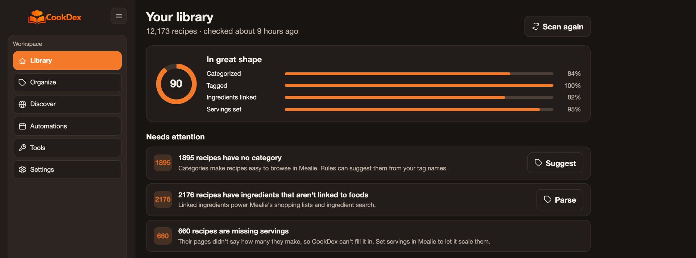
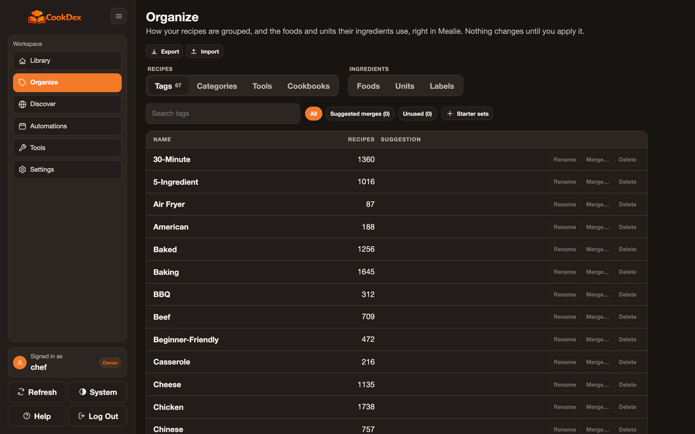
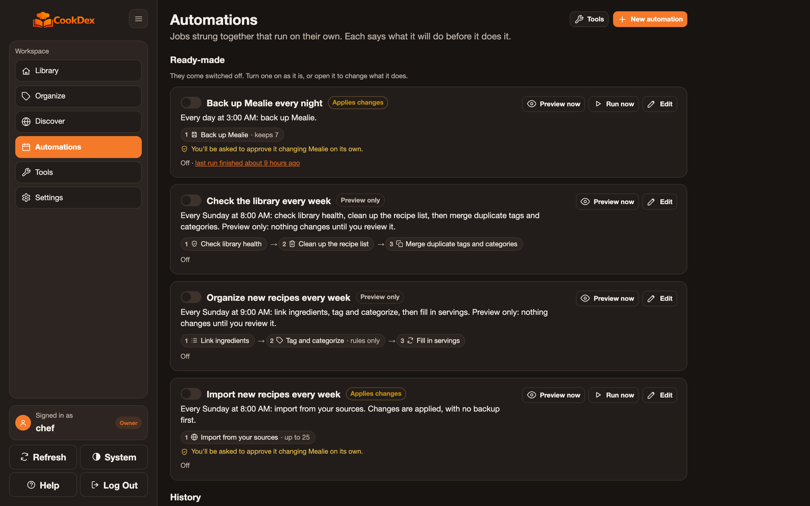
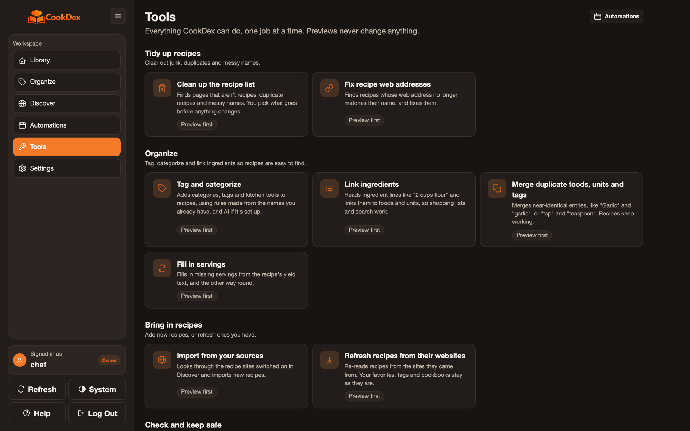
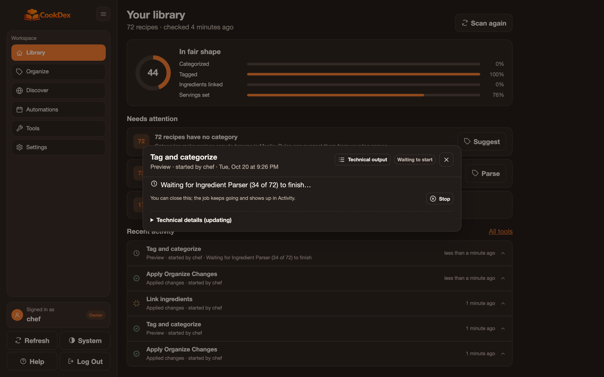
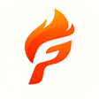

# CookDex

<p>
  
  
  
  
  
</p>

CookDex is a web UI for keeping a self-hosted [Mealie](https://mealie.io) recipe library clean, searchable, and well organized: import recipes, clean messy scraper results, keep categories and tags consistent, schedule maintenance jobs, and review library health. Every cleanup task previews its changes first.

**Documentation: [knownframe.com/cookdex/docs](https://knownframe.com/cookdex/docs/)**



<table>
  <tr>
    <td></td>
    <td></td>
  </tr>
  <tr>
    <td></td>
    <td></td>
  </tr>
</table>

## Cook from your library with Forked



[Forked](https://apps.apple.com/us/app/forked-recipes/id6760947117), also from
Knownframe, is a native iPhone and iPad app for your Mealie library: browse
recipes as photo cards, plan your meals, and keep a shopping list that stays in
step with Mealie. The cleanup CookDex does is what makes it work well:

- **Tags and categories** drive its filters and smart cookbooks.
- **Parsed ingredients** combine on the shopping list and let diet and allergy filters see each food.
- **Servings** let every recipe scale its amounts.

Free to download. Forked Pro is an optional one-time upgrade. Roadmap and
feature requests are at
[Knownframe/forked-for-mealie](https://github.com/Knownframe/forked-for-mealie).

<a href="https://apps.apple.com/us/app/forked-recipes/id6760947117"></a>

## Quick Start

```bash
mkdir -p cookdex && cd cookdex
curl -fsSL https://raw.githubusercontent.com/thekannen/cookdex/main/compose.ghcr.yml -o compose.yaml
docker compose pull cookdex
docker compose up -d cookdex
```

Open `https://your-server:4820/cookdex`, accept the self-signed certificate warning, and create the first admin account. Then follow [Getting started](https://knownframe.com/cookdex/docs/getting-started/).

## Using Discover responsibly

Discover finds recipes on sites you choose and copies them into your own Mealie. You run CookDex yourself, so you decide which sites it visits, and checking and following each site's terms of use is up to you. Before anyone can use Discover, an owner has to accept this in the app.

- **Suggested sources are checked first.** A site is only suggested if its terms of use didn't ban automated access when we read them. Each suggestion records when that was. Terms change, so check them again yourself. Sites you add yourself aren't checked by anyone.
- **CookDex is a polite visitor.** It says who it is in every request, follows each site's robots.txt, waits between requests, and never tries to get around a site that refuses it.
- **It's for your own collection.** Don't use Discover to republish other people's recipes.
- **No warranty.** CookDex is provided as-is under the [AGPL-3.0](LICENSE), without warranty, and its authors aren't liable for how it's used.

## Documentation

- [Install](https://knownframe.com/cookdex/docs/install/): volumes, image tags, secrets and updating
- [Getting started](https://knownframe.com/cookdex/docs/getting-started/): first login and a first safe run
- [Task reference](https://knownframe.com/cookdex/docs/tasks/): every task's options; see also [Scheduling and automations](https://knownframe.com/cookdex/docs/scheduling/) and [Safety policies](https://knownframe.com/cookdex/docs/safety-policies/)
- [Data maintenance](https://knownframe.com/cookdex/docs/data-maintenance/) · [Database connection](https://knownframe.com/cookdex/docs/database-connection/) · [Recipe Dredger](https://knownframe.com/cookdex/docs/recipe-dredger/)
- [Troubleshooting](https://knownframe.com/cookdex/docs/troubleshooting/) · [Privacy and safety](https://knownframe.com/cookdex/docs/privacy-and-safety/)

For contributors: [Local Dev](docs/LOCAL_DEV.md), [API routes](docs/API.md), [Providers](docs/PROVIDERS.md), [CONTRIBUTING.md](CONTRIBUTING.md).

## Getting Help

- The **Help** page inside CookDex documents every task and setting in place.
- Bugs and feature requests: [open an issue](https://github.com/thekannen/CookDex/issues).

## Contributing

CookDex is AGPL-3.0 and contributions are welcome. See [CONTRIBUTING.md](CONTRIBUTING.md). If CookDex is useful to you, starring the repo helps other Mealie users find it.

## Support

CookDex is free and built in my spare time. If it saves you time, [sponsoring on GitHub](https://github.com/sponsors/thekannen) helps cover hosting and the test Mealie instance every release is checked against. One-time tips are welcome too.
